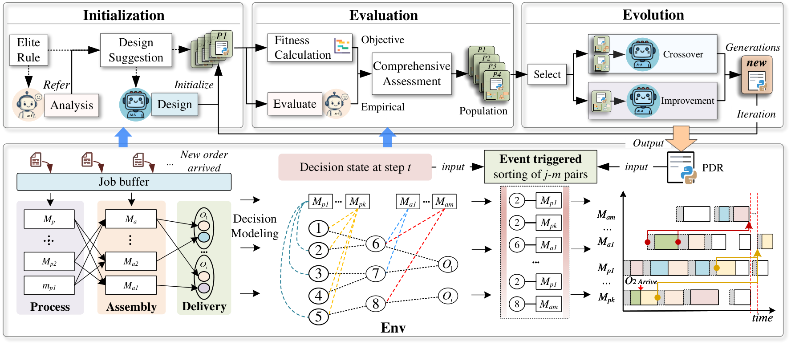
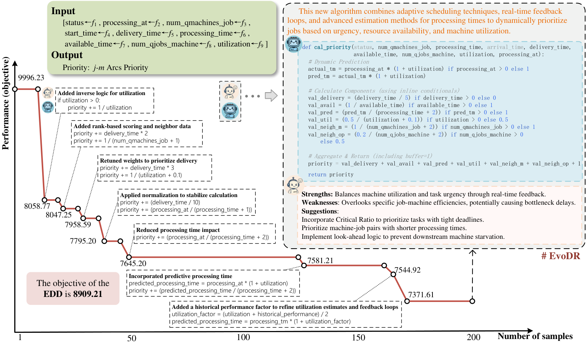

# EvoDR: Evolving Dispatching Rules via Large Language Model for Dynamic Flexible Assembly Flow Shop Scheduling

[]()
[](https://opensource.org/licenses/MIT)
[](https://github.com/jhqiu1/EvoDR/releases)
[](https://arxiv.org/abs/2601.15738)
[](README_CN.md)
<!-- Once available, enable:
[](https://jhqiu1.github.io/evodr)
-->

**EvoDR** automatically evolves priority dispatching rules (PDRs) for the **dynamic flexible assembly flow shop scheduling problem (FAFSP)** with dual kitting constraints — component kitting before assembly and multi-product consolidated delivery per order. A dual-expert mechanism lets **LLM-A** generate executable rule code while **LLM-S** provides scheduling-specific analysis and improvement suggestions; objective fitness remains the sole basis for selection, and semantic feedback only steers rule generation.

> This repository contains the core EvoDR framework with a runnable FAFSP example. The comparative AHD baselines (GP/GEP/FunSearch/EOH/MCTS-AHD/ReEvo) and the robustness datasets (24 scenarios) are not included. The `ablations/` folder contains the EDR-S variants used in the paper's ablation study; the small suggestion pool there (4 generic suggestions) is the one used for the reported Table VI results.

## 📖 Introduction

### 🎨 Design Paradigm

Dynamic scheduling under kitting constraints calls for real-time dispatching. Three design routes are compared:

1. 👤 **Expert PDRs** (EDD, FIFO+SPT, ...) — fast and interpretable, but highly sensitive to operating conditions and degrade under high load
2. 🔧 **GP-based automatic design** — restricted to fixed terminal sets, hard to exploit dynamic state semantics
3. 🚀 **EvoDR (Ours)** — co-evolves rules and design knowledge in language space, adapting to dynamic scheduling features

### 🏗️ EvoDR Framework

- 🔥 **Elite Knowledge Guided Initialization.** An elite rule (EDD) is analyzed by LLM-S; its strengths, limitations, and improvement directions are injected into the initial population.
- 🧠 **Dual-Expert Co-Evolution.** LLM-A generates PDRs from prompts (C1/C2/M1/M2); LLM-S evaluates rules against dynamic features and population context, returning structured suggestions.
- ⚖️ **Hybrid Evaluation.** Two independent channels: objective fitness from the simulator (the sole basis for best-solution update, parent and survival selection) and a semantic channel from LLM-S (only injected into the next generation prompt).
- 🔁 **Four Evolutionary Operators.** C1 dominance-fusion crossover, C2 exploratory crossover, M1 directed optimization (driven by LLM-S suggestions), M2 parameter tuning.

<p align="center"></p>
<p align="center"><em>Overview of the EvoDR framework for dynamic FAFSP: initialization, hybrid evaluation, and co-evolution.</em></p>

### 📐 Problem and Scale

Scheduling decisions are modeled as priority ranking of feasible job–machine pairs on a heterogeneous graph, triggered at every job completion or order arrival. Per instance:

| Item | Range |
|---|---|
| Customer orders (incl. 20–50 dynamic arrivals) | 30–60 |
| Products (assembly jobs) | 39–110 |
| Component tasks | 78–250 |
| Total jobs | 117–355 |
| Assembly lines (main + sub) | 9–17 (3+6 to 5+12) |
| Feasible job–machine pairs per decision step | 577–3253 |

### 🏆 Key Results

- **vs. AHD methods** (GP, GEP, RandSample, FunSearch, EOH, MCTS-AHD, ReEvo; 20 industrial instances, 200 samples each): average tardiness 3.17–16.81% lower; +18.63% over EDD on the test set; Friedman + Wilcoxon confirmed (all p ≤ 0.0025, Bonferroni-corrected).
- **Robustness** (480 instances, 24 scenarios varying resource scale, flexibility, arrival volume, and load factor): best or near-best performance in the vast majority of scenarios; lowest overall average tardiness with ARI 35.62% over EDD.
- **Cost**: ~$0.189 and 0.46M tokens per offline design run with GPT-4o-mini; online dispatching requires only a single priority ranking per decision step — no LLM calls, sub-millisecond response.

<p align="center"></p>
<p align="center"><em>Evolution process with LLM-S feedback: each drop corresponds to an accepted rule improvement, reaching 7371.61 versus EDD's 8909.21 within 200 samples.</em></p>

## 📦 Requirements

- Python >= 3.10
- `numpy`, `pandas`, `scipy`, `matplotlib`, `PyYAML`
- `openai` (for GPT-4o-mini or other OpenAI-compatible APIs)

```bash
pip install -r requirements.txt
```

## ⚡ Quick Start

1. **Set your LLM credentials**:

```bash
export LLM_API_KEY="your-api-key"
export LLM_BASE_URL="https://api.openai.com/v1"
export LLM_MODEL="gpt-4o-mini"
```

2. **Run EvoDR**:

```bash
cd example/online_fafsp
python run_evodr.py
```

The run executes elite-guided initialization and co-evolution on the bundled 20-instance FAFSP set (`data_test/m13-m26-f0.5-arrive20-u1.txt`). See [`EVODR.md`](EVODR.md) for how to migrate the framework to a new problem domain.

## 📁 Repository Structure

```
evodr/
├── base/               # Core utilities (code parsing, evaluation, LLM interface)
├── method/evodr/       # EvoDR algorithm implementation
│   ├── evodr.py        # Main algorithm (dual-expert co-evolution)
│   ├── population.py   # Population management
│   ├── prompt.py       # Prompt templates for operators (C1/C2/M1/M2/F1)
│   ├── prompt_algo.py  # LLM-A task description and input/output definitions
│   ├── prompt_sche.py  # LLM-S evaluation prompt design
│   ├── sampler.py      # LLM sampling and response parsing
│   ├── profiler.py     # Experiment logging
│   └── ablations/      # Ablation variants (EDR-C/E/M/DE/D/S series)
├── task/optimization/online_fafsp/  # Scheduling simulator
│   ├── schedule.py     # Event-driven scheduler
│   ├── state.py        # System state (heterogeneous graph MDP, 9 features)
│   ├── evaluation.py   # Fitness evaluation
│   ├── get_instance.py # Data loading
│   ├── heuristic.py    # Classical PDR baselines
│   └── template.py     # PDR code template
└── tools/
    ├── llm/            # LLM API wrappers (OpenAI, vLLM, Ollama)
    └── profiler/       # Logging profilers

example/online_fafsp/
├── run_evodr.py        # Main run script
└── data_test/          # Bundled instance set (20 instances)
```

## 🔖 Citation

If you find EvoDR helpful for your research or applied projects, please cite:

```bibtex
@article{qiu2026evodr,
  title={EvoDR: Evolving Dispatching Rules via Large Language Model for Dynamic Flexible Assembly Flow Shop Scheduling},
  author={Qiu, Junhao and Zhuang, Haoyang and Liu, Fei and Liu, Jianjun and Zhang, Qingfu},
  journal={IEEE Transactions on Evolutionary Computation},
  year={2026},
  note={arXiv:2601.15738}
}
```

If you are interested in LLM-based automatic heuristic design, you can also check [E2OC](https://github.com/jhqiu1/E2OC) and [LLM4AD](https://github.com/Optima-CityU/LLM4AD).

If you encounter any difficulty using the code, please contact [junhaoqiu2-c@my.cityu.edu.hk](mailto:junhaoqiu2-c@my.cityu.edu.hk) or submit an issue.

## 📜 License

This project is licensed under the MIT License. See [LICENSE](LICENSE) for details.
