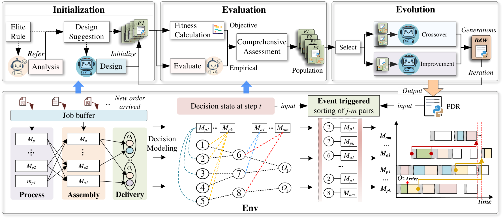
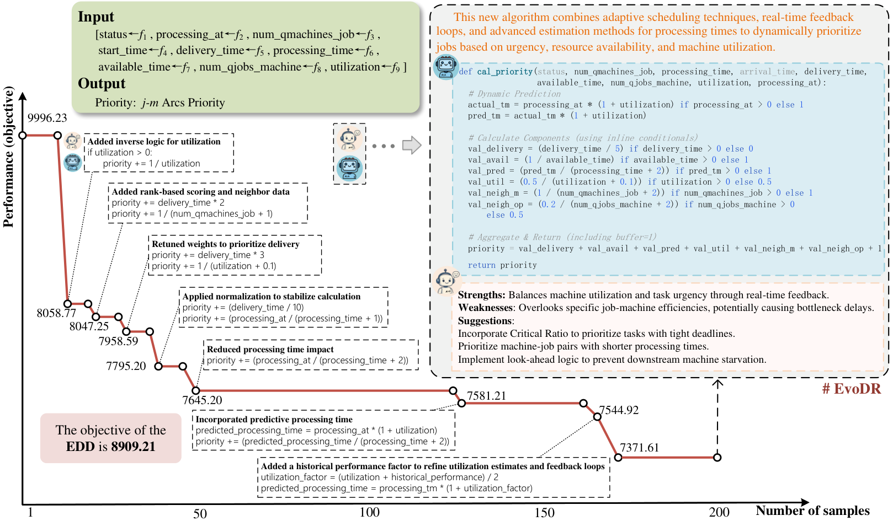

<div align="center">

# ⚡ EvoDR

### 一个会自己设计调度规则的调度专家。

**在语言空间里进化，而不是在符号树里搜索。**

[]()
[](https://opensource.org/licenses/MIT)
[](https://github.com/jhqiu1/EvoDR/releases)
[](https://arxiv.org/abs/2601.15738)
[](README.md)

</div>

订单随时在来，每一单都要所有部件、所有产品齐套才能交付。手工设计调度规则是一场打不赢的仗，GP 式的自动设计又困在符号树里出不来。

**EvoDR 派两个 LLM 上场：**

> 🧠 **一个写规则，一个看产线。**
> LLM-A 生成可执行的规则；**LLM-S** 作为调度专家，盯着进化中的种群，指出谁在干活、谁是死重，引导下一代往哪走。
>
> *模拟器决定谁活下来，专家决定接下来试什么。*

进化出来的规则**亚毫秒**响应、在线**零** LLM 调用、设计成本**只要 $0.189**。

<div align="center">

| 🏆 干翻 7 个 AHD 基线 | 📊 480 实例 · 24 工况 | 💸 $0.189 一次设计 | ⚡ <1 ms 每次决策 |
|---|---|---|---|

</div>

📄 **[IEEE Transactions on Evolutionary Computation, 2026](https://arxiv.org/abs/2601.15738)**

<p align="center"></p>

## 🧠 核心思想

现有的 LLM 算法设计回路都只向模型要**代码**。EvoDR 多要了一样东西：**判断力**。第二个领域专家 LLM 观察整个搜索过程，读最好的和最差的规则，把干巴巴的适应度数字翻译成语义引导——"这条规则饿死了总装工位"、"那个权重没在干活"。

这些引导不碰选择，只塑造下一代生成什么。这个模式可以装进任何 LLM 驱动的算法设计回路，适配任何复杂排产或优化问题。

## ⚙️ 进化回路

- 🔥 **从 EDD 冷启动** —— LLM-S 解剖一条经典规则，第一代种群围绕它的短板生成
- 🔀 **四个算子** —— C1 融合父代长处 · C2 要求完全不同 · M1 把专家建议写成代码 · M2 重调权重
- 🏁 **部署即忘** —— 进化出的规则就是一个优先级函数：每个决策步对 577–3253 个作业–产线配对排序，运行时不带任何模型

<p align="center"></p>
<p align="center"><em>每一次下降都是一次被专家引导的规则改进：200 次采样内 7371.61，EDD 为 8909.21。</em></p>

## 📊 数字说话

| 战场 | 结果 |
|---|---|
| 对阵 GP · GEP · RandSample · FunSearch · EOH · MCTS-AHD · ReEvo（20 个工业实例） | 平均拖期低 **3.17–16.81%**，测试集比 EDD 高 18.63% |
| 鲁棒性：24 工况、480 实例（3+6 → 5+12 产线、20–50 到达、负载 1–4×） | 始终最优或接近最优，总体 ARI **35.62%** |
| 一次完整设计（GPT-4o-mini） | **$0.189**，0.46M tokens |
| 在线调度 | **< 1 ms**，零 LLM 调用 |
| 显著性 | Friedman + Wilcoxon，全部 p ≤ 0.0025（Bonferroni 校正） |

## 🚀 快速开始

```bash
pip install -r requirements.txt
export LLM_API_KEY="your-api-key" LLM_BASE_URL="https://api.openai.com/v1" LLM_MODEL="gpt-4o-mini"
cd example/online_fafsp && python run_evodr.py
```

想把 EvoDR 搬到自己的问题：定义状态、动作，以及你的领域专家该看什么——[`EVODR.md`](EVODR.md) 有完整迁移指南。

## 🔖 引用

```bibtex
@article{qiu2026evodr,
  title={EvoDR: Evolving Dispatching Rules via Large Language Model for Dynamic Flexible Assembly Flow Shop Scheduling},
  author={Qiu, Junhao and Zhuang, Haoyang and Liu, Fei and Liu, Jianjun and Zhang, Qingfu},
  journal={IEEE Transactions on Evolutionary Computation},
  year={2026},
  note={arXiv:2601.15738}
}
```

我们组的其他工作：[E2OC](https://github.com/jhqiu1/E2OC) · [LLM4AD](https://github.com/Optima-CityU/LLM4AD) · [junhaoqiu2-c@my.cityu.edu.hk](mailto:junhaoqiu2-c@my.cityu.edu.hk)

## 📜 许可证

MIT，见 [LICENSE](LICENSE)。
